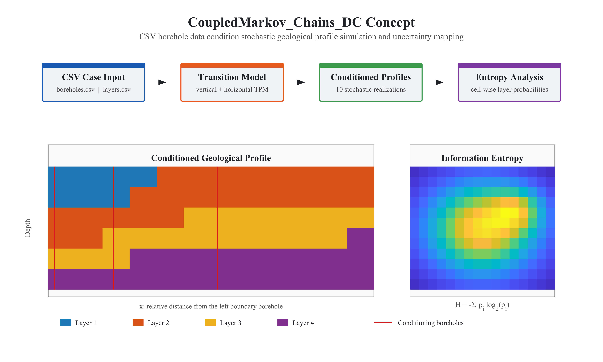

# CoupledMarkov_Chains_DC

MATLAB implementation of a Coupled Markov Chain workflow for conditioned geological profile simulation. Cases are defined with plain CSV files, so users can change borehole layouts, layer sequences, grid resolution, and simulation counts without editing MATLAB code.

## Concept

The workflow reads standardized CSV borehole data, estimates vertical and horizontal transition probabilities, generates conditioned stochastic profiles, and summarizes grid-cell uncertainty with information entropy.



## Project Layout

```text
main.m                         # Default entry point
concept/                       # MATLAB concept figure script and image
src/+cmc/                      # MATLAB package
src/+cmc/+io/                  # CSV readers and validation
src/+cmc/+model/               # CMC transition and simulation logic
src/+cmc/+plot/                # Profile plotting
examples/boreholedata/         # Standard CSV case input
examples/boreholedata/reference/
outputs/profile/               # Generated profile grids and figures
outputs/entropy/               # Generated layer probabilities and entropy maps
```

## Run a Case

From the repository root:

```powershell
matlab -batch "run('main.m')"
```

By default, `main.m` runs the bundled case in `examples/boreholedata/` and writes generated results to `outputs/`. The number of profile realizations, base grid spacing, optional grid refinement, and random seed are controlled by `case_config.csv`, not hard-coded in the runner.

For a custom case, use MATLAB directly:

```matlab
addpath('src')
cmc.runCase('path/to/case_directory', 'outputs')
```

Generated files follow this structure:

- `outputs/profile/profile_*.csv`: simulated layer grids
- `outputs/profile/profile_*.png`: profile figures
- `outputs/entropy/probability_layer_*.csv`: cell-wise layer probabilities
- `outputs/entropy/entropy.csv`
- `outputs/entropy/entropy.png`

Set `num_simulations` to control how many realizations are generated. Set `dx_m` and `dz_m` for the base CSV grid spacing. If `grid_refinement` is greater than 1, the borehole layer grid is refined at runtime; for example, a 0.5 m base grid with `grid_refinement=2` runs on an effective 0.25 m grid.

## Example Outputs

The bundled case is configured with 10 simulations and `grid_refinement=2`. Two example realizations are shown below:


Information entropy is computed per grid cell from the simulated layer frequencies. Entropy uses `log2`, so the maximum uncertainty is `log2(num_soil_types)` bits.


## CSV Input Contract

Each case directory must contain:

- `case_config.csv`: key/value settings such as soil count, base grid size, optional refinement, `K` values, simulation count, and random seed.
- `boreholes.csv`: borehole metadata with `grid_col`, `is_training`, and `is_conditioning`.
- `borehole_layers.csv`: long-format borehole layers with `borehole_id,depth_m,layer_id`.
- `soil_types.csv`: layer ID labels.

Layer IDs must be integer values from `1` to `num_soil_types`. `grid_col` is 1-based and refers to the base grid before optional refinement. The cleaned bundled example removes the original workbook's trailing zero sentinel row/column.

Common configurable fields in `case_config.csv`:

- `num_simulations`: number of stochastic realizations.
- `dx_m`, `dz_m`: base horizontal and vertical grid spacing.
- `grid_refinement`: integer refinement factor applied at runtime.
- `k_values`: one horizontal persistence factor per soil type.
- `random_seed`: controls deterministic reproducibility.

## License

MIT
